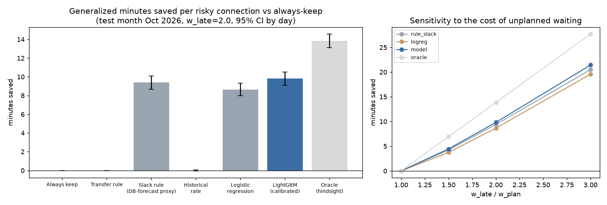

# Will I make my connection?

A calibrated decision engine for train transfers at four German hubs (Leipzig, Erfurt, Halle (Saale), Berlin Hbf).
Some minutes before your train **A** arrives, it estimates **P(miss)** for your planned change to train **B**. It then
tells you whether to *keep the plan* or *commit now to the next alternative*, and why.

**Result (held-out Oct 2026, 885k connection×lead rows):** the calibrated LightGBM saves **9.8 generalized minutes
per risky connection** vs always-keep (95% CI 9.1–10.5). That is 71% of what hindsight-perfect switching would save,
and **+0.43 min (CI 0.36–0.49)** more than the best simple rule. In pure minutes, nothing can beat "always keep"
(proof in [DESIGN §1.1](docs/DESIGN.md)). The value exists only because unplanned waiting is weighted 2× planned
waiting, and results at weights 1–3 are reported alongside. One release guardrail fails (commit rate on safe
connections: 1.74% vs ≤ 1%). A serving gate, pre-registered before the next month is scored, closes it at a cost of
~0.03 min per connection. Full results: **[docs/EVALUATION.md](docs/EVALUATION.md)**.



## How it works

```
HF deutsche-bahn-data (Aug–Oct 2026) ─┐
Bright Sky / DWD weather ─────────────┼─► DuckDB ─► dbt staging + marts ─► candidate connections, labels, lost time
DB Timetables API (live, hourly) ─────┘                                     │
                                                                             ▼
                      leakage-free features at t_pred = arrival − {30, 10} min  (OOF historical rates)
                                                                             ▼
             baselines · logistic regression · LightGBM ×3 seeds + Platt  ─►  P(miss)
                                                                             ▼
                cost model: commit iff  P > w_plan / w_late   (Ê = extra time of the alternative)
                                                                             ▼
       policy simulation with actual outcomes · failure slices · monitoring/shadow replay · Streamlit app
```

## Quickstart

Requires [uv](https://docs.astral.sh/uv/) and about 3 GB of free disk.

```bash
make setup         # locked Python 3.12 env
make reproduce     # data → dbt → connections → features → train → fallback → policy → failure → monitor → app-bundle → test
make app           # dashboard at http://localhost:8501
```

Run `make help` to list every step. Each step can be run on its own once its inputs exist. `make test` and
`make lint` work without the data; warehouse-dependent tests skip. The live collector (`make collect`) needs
`DB_CLIENT_ID` / `DB_API_KEY` from the DB API Marketplace (see `.env.example`). Without them it skips cleanly.

To run only the dashboard, without the pipeline: `uv sync && make app`. It reads the committed `app/bundle/` only.

## Repository map

| Path | What |
|---|---|
| `src/cre/ingest/` | HF loader, weather, DB Timetables client (with rate limit, retries, contracts) |
| `src/cre/contracts/` | pandera schemas; invalid batches are quarantined, not written |
| `dbt/` | staging + `fct_stop_events` mart, schema + regression tests |
| `src/cre/connections/` | candidate connections, miss labels, lost time `L`, alternatives |
| `src/cre/features/` | features known at `t_pred` only; out-of-fold historical rates |
| `src/cre/models/` | baselines, LightGBM, calibration, static fallback, serving |
| `src/cre/decision/` | cost model and recommendation text |
| `src/cre/evaluate/` | metrics with by-day bootstrap, policy simulation, failure analysis, app export |
| `src/cre/monitor/` | freshness, ECE, decision value, PSI, shadow promotion rules |
| `app/` | Streamlit dashboard + its data bundle |
| `.github/workflows/` | CI (lint, tests, dbt parse), hourly collection, daily monitoring |

## Documentation

- [DESIGN](docs/DESIGN.md): the user, the decision, the cost model, baselines, rejected approaches (written before modelling)
- [EVALUATION](docs/EVALUATION.md): results, sensitivity, failure slices, guardrails, limitations
- [DECISIONS](docs/DECISIONS.md): every judgment call, by phase
- [FEATURES](docs/FEATURES.md) · [DATA_CONTRACTS](docs/DATA_CONTRACTS.md)
- [OPERATIONS](docs/OPERATIONS.md): fallback, monitoring, retraining, shadow mode, rollback, runbook
- [POSTMORTEM](docs/POSTMORTEM.md): real failures during the build
- [EDA notebook](notebooks/01_eda.md) · [base rates](reports/base_rates.md)

## Data and licence

Train data: [piebro/deutsche-bahn-data](https://huggingface.co/datasets/piebro/deutsche-bahn-data), derived from
Deutsche Bahn timetable data, **CC BY 4.0**. Weather: DWD via [Bright Sky](https://brightsky.dev/), open data.
Holidays: OpenHolidays API (frozen in `configs/holidays_2026.csv`). `app/bundle/` contains data derived from these
sources under the same terms. This project is not affiliated with or endorsed by Deutsche Bahn.
