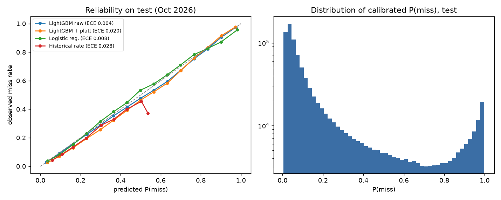
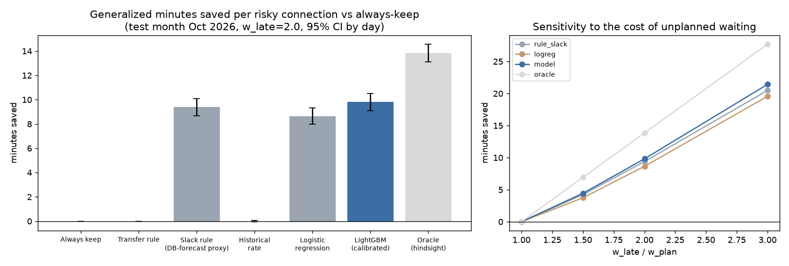
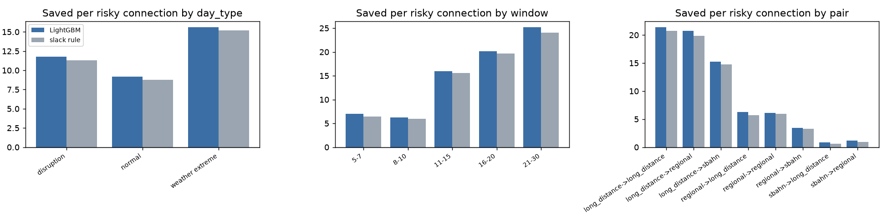
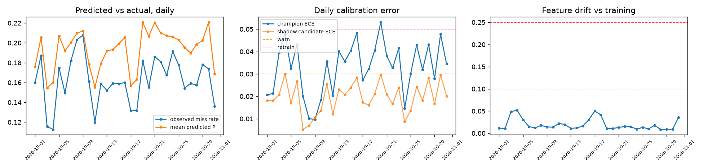

# EVALUATION: does the model make better decisions?

All numbers are on the held-out test month (**October 2026**). Nothing was tuned on it. The sources are
`reports/model_metrics.json`, `reports/policy_metrics.json`, `reports/failure_analysis.json`,
`reports/fallback_metrics.json` and `reports/monitoring/replay_summary.json`. 95% CIs come from a bootstrap
**by day** (DESIGN §2). Regenerate everything with `make reproduce`.

## TL;DR

- The calibrated LightGBM saves **9.8 generalized minutes per risky connection** vs always-keep
  (95% CI 9.1–10.5, n = 257,606 risky connection×lead rows, `w_late = 2`). Hindsight-perfect switching saves 13.8,
  so the model captures **71% of the achievable value**.
- The best baseline is the val-tuned **slack rule** ("switch if naive slack < 4 min"), at 9.4 min. The model beats it by
  **+0.43 min per risky connection (paired CI 0.36–0.49)**. The gain is real but small. Most of the value comes
  from *framing the decision with a cost model at all*, and a one-line rule gets most of it.
- In **pure minutes (`w_late = 1`) every policy saves exactly 0**, as DESIGN §1.1 predicts. Any time saving
  claimed here comes from valuing unplanned waiting above planned waiting.
- **Guardrails: 3 of 5 pass, 1 fails, 1 is unmeasured.** The failing one now has a pre-registered fix (§5). The model's commit rate on non-risky connections is
  **1.74% against a 1% limit**. The fallback model's ECE is **0.031 against 0.03**. Details in §5.

## 1. Probability quality (classifier)

| Model | Brier | Log loss | ROC AUC | ECE |
|---|---|---|---|---|
| Transfer-time rule (as a probability) | 0.143 | 0.456 | 0.627 | 0.029 |
| Historical rate (station × window × hour) | 0.140 | 0.444 | 0.695 | 0.028 |
| Slack rule (delay-propagation proxy) | 0.106 | 0.365 | 0.740 | 0.021 |
| Logistic regression | 0.097 | 0.327 | 0.853 | **0.008** |
| LightGBM, raw (3-seed mean) | **0.076** | **0.261** | **0.907** | **0.004** |
| **LightGBM + Platt (shipped)** | 0.077 | 0.264 | **0.907** | 0.020 |

- By-day CIs for the shipped model: Brier 0.073–0.080, AUC 0.901–0.912, ECE 0.014–0.025.
- AUC 0.91 is high but below the "> 0.95 = bug" tripwire. Leakage tests (`tests/test_features_leakage.py`)
  recompute every feature with all post-`t_pred` rows removed and assert equality.
- **Platt scaling made test calibration worse** (0.004 → 0.020). The cause is the base-rate shift between validation
  (21.1% misses) and October (18.4%). We kept the pre-registered choice. See POSTMORTEM #2.
- Asking later helps ranking (AUC 0.929 at 10 min vs 0.881 at 30 min: more of A's delay is known). Both leads stay calibrated
  (ECE 0.019 / 0.021).
- Top features by gain: `naive_slack` (38%), A's known delay, minutes since A was last observed, remaining planned
  run time. Weather adds little. Temperature has 2.9% gain, which is a seasonality risk (§6).

## 2. Decisions (the metric that matters)

Generalized minutes saved per **risky** connection vs always-keep, `w_late/w_plan = 2`:

| Policy | Saved / risky conn. | 95% CI | Commit rate | Unnecessary switches | Missed warnings |
|---|---|---|---|---|---|
| Always keep | 0.00 | — | 0% | 0% | 43.6% |
| Transfer-time rule | 0.00 | — | 0% (tuning chose "never") | 0% | 43.6% |
| Historical rate | 0.00 | −0.05 – 0.05 | 1.9% | 0.9% | 42.7% |
| Logistic regression | 8.65 | 7.97 – 9.33 | 31.6% | 4.5% | 18.2% |
| Slack rule (X = 4 min) | 9.39 | 8.67 – 10.07 | 33.4% | 4.5% | 15.7% |
| **LightGBM (calibrated)** | **9.82** | **9.08 – 10.52** | 41.0% | 6.4% | **10.8%** |
| Oracle (hindsight) | 13.85 | 13.10 – 14.57 | 43.6% | 0% | 0% |

*Unnecessary switch* = committed, but keeping would have cost less. *Missed warning* = kept, but switching would have
cost less.

- **Model − slack rule (paired, same resampled days): +0.43 min / risky connection, CI 0.36–0.49.** The model
  switches more often. It accepts 1.9 pp more unnecessary switches and in exchange cuts missed warnings by 4.9 pp.
- Over *all* connections (risky + safe) the numbers are diluted as expected: model 2.88, rule 2.73, oracle 4.81.
- By lead time: at 10 min the model saves 10.56 vs 10.08 for the rule. At 30 min it saves 9.06 vs 8.69. The model's
  edge is similar at both leads.
- Logistic regression has the best ECE, but it is a weaker *decider* than the slack rule. Calibration is necessary
  for a good decision, not sufficient.

### 2.1 Sensitivity

**Weight on unplanned waiting.** The rule threshold is re-tuned on val for each weight. The probability threshold
follows from the cost model (`P > w_plan / w_late`) and is never tuned.

| w_late / w_plan | Slack rule | Logreg | **LightGBM** | Oracle |
|---|---|---|---|---|
| 1.0 (pure minutes) | 0.00 | 0.00 | **0.00** | 0.00 |
| 1.5 | 4.23 | 3.74 | **4.45** | 6.92 |
| 2.0 (headline) | 9.39 | 8.65 | **9.82** | 13.85 |
| 3.0 | 20.49 | 19.57 | **21.43** | 27.70 |

The ranking is stable across weights. The absolute size of the saving depends entirely on the weight.

**Minimum transfer time.** The test month is relabelled with MCT ± 2 min. The model is kept as trained.

| MCT offset | Miss rate | Slack rule | LightGBM |
|---|---|---|---|
| −2 min | 13.2% | 7.80 | **8.08** |
| 0 | 16.3% | 9.39 | **9.82** |
| +2 min | 23.2% | 10.71 | **11.37** |

The model stays ahead when the MCT assumption is wrong in either direction.

## 3. Where it fails (Phase 8)

Source: `reports/failure_analysis.json`, `reports/figures/failure_slices.png`. Disruption days are derived from the
data (top-decile miss or cancellation share): Oct 1, 2, 8, 9, 12, 24.

- **The model beats the rule in every slice** of day type, station, transfer window, train-type pair and lead.
  The margin is small everywhere (0.2–0.9 min).
- **Day type:** disruption days 11.8 vs 11.3. Weather extremes 15.6 vs 15.2 (n = 15k only). Normal days 9.2 vs 8.8.
  Calibration is *best* on disruption days (ECE 0.013) and worst on normal days (0.037). The model over-predicts
  misses on quiet days, which matches the base-rate shift above.
- **Worst single day:** Oct 4, the only day where the model loses to the rule (−0.04 min / risky connection).
- **Calibration hot spots (ECE > 0.03, policy frame):** 5–7 min windows (0.040), long-distance → long-distance (0.043),
  regional → S-Bahn (0.039), Berlin (0.036), lead 30 (0.036).
- **Little value at S-Bahn → long-distance/regional** (0.8–1.2 min). Those are mostly safe connections: miss rate 6%,
  and S-Bahn headways make the "alternative" cheap anyway.

## 4. Static fallback model

When live data is stale (> 120 min) the app serves a model without live delays: timetable, calendar, weather and
historical rates only.

| | Full model | Fallback |
|---|---|---|
| ROC AUC | 0.907 | 0.789 |
| Brier | 0.077 | 0.121 |
| ECE | 0.020 | **0.031** |

The fallback is barely better than the slack rule at ranking (0.79 vs 0.74). Without live data it cannot know
the delay that is already happening, and that delay drives most misses. "Reduced confidence" therefore costs a
lot, and the UI says so.

## 5. Guardrails (DESIGN §2)

| Guardrail | Limit | Result | Status |
|---|---|---|---|
| Calibration, overall | ECE ≤ 0.03 | 0.020 | ✅ |
| Calibration, per lead | ECE ≤ 0.03 | 0.019 (10 min), 0.021 (30 min) | ✅ |
| Coverage of the full model | ≥ 90% | not measurable offline: no live credentials (OPERATIONS §7) | ⚪ unmeasured |
| Commit rate on **non-risky** connections | ≤ 1% | **1.74%** (10,914 commits) | ❌ |
| Pure-minute result reported | — | 0.00 for every policy | ✅ |
| (Fallback calibration, OPERATIONS §2) | ECE ≤ 0.03 | **0.031** | ❌ (marginal) |

**About the non-risky breach.** These commits are not obviously bad. 44% are right in hindsight, the net effect is
**+2.06 generalized min per commit**, and 11% are connections where B was cancelled. Even the hindsight oracle commits on
4.5% of non-risky connections. But the guardrail encodes a product rule, "don't tell people to abandon a safe-looking
connection", which the minute metric doesn't price. The pre-registered rule says this **blocks a release**.
Options, all to be validated on the *next* month and not on October:
(a) gate commits to `naive_slack < 10` (by construction this drops the rate to 0% and loses at most the +2 min × 1.7%
these commits earn);
(b) require a higher P on non-risky connections;
(c) argue for changing the guardrail. That needs a DECISIONS entry *before* looking at new data.

**Chosen (pre-registered 2026-11-27, DECISIONS Phase 11): option (a).** Serving never advises switching when
`naive_slack ≥ 10` (`decision.commit_gate_slack_min`). On risky connections the gate changes nothing, because it only
touches non-risky ones. On October the gate would cost 10,914 × 2.06 / 885,054 ≈ **0.025 min per connection overall**
(2.883 → 2.857). This is arithmetic on the reported numbers, not a re-tuned result. The October headline stays
ungated. The gated policy's first honest test is the next month.

## 6. Monitoring replay and shadow mode (Phase 9)

`make monitor` replays October day by day through the production rules (`src/cre/monitor/rules.py`).

- **Calibration alarms fired, as designed.** The rolling 7-day ECE crossed the 0.03 WARN line on **20 of 31 days**
  (peak 0.040 on Oct 20–21). It never crossed the 0.05 RETRAIN line. On a live system this is the early
  signal for POSTMORTEM #2.
- **No ROLLBACK:** decision value never went below 0 for 3 consecutive days. **No FALLBACK:** no data gaps.
- **Shadow candidate:** the same recipe on fresher data (training through Sep 22, isotonic calibration on Sep 23–30),
  scored on Oct 1–14 alongside the champion.

  | | Champion | Candidate |
  |---|---|---|
  | Log loss | 0.2465 | **0.2433** (−0.0032, gate needs ≥ 0.002) |
  | ECE | 0.026 | **0.012** |
  | Saved / risky conn. | — | +0.012 vs champion |

  → **Verdict: promote.** Fresher data plus a calibrator fitted closer to deployment fixes most of the drift.

- **Drift:** key features (delays, slack, windows, historical miss rate, rain) have PSI < 0.01. The large shift is
  **`temperature_c`, PSI 3.06**: an August/September → October season change. Temperature is not a key monitored
  feature, so no action fired. It does carry 2.9% of the model's gain, which makes it a seasonality risk. For the
  next retrain, drop it or replace it with a de-seasonalised anomaly. `hist_b_cancel_rate` (0.15) is above WARN.

## 7. Honest limitations

1. **Equal weighting of connections.** Without passenger counts, every candidate connection counts the same (DESIGN §7.3).
2. **The weight is the result.** At `w_late = 1` nothing helps. The headline uses 2.0, which comes from transport
   appraisal practice (DESIGN §1.1), not from measurement.
3. **Train/serve skew.** Training used last realized upstream delays. Live serving would use DB's forecast. The skew is
   unmeasured until live credentials exist.
4. **One test month**, in autumn. Winter (snow, frozen switches) has not been seen.
5. **Alternatives = the next train from S to B's next stop.** Re-routing via other hubs is ignored, so `L` and `E`
   are overstated for well-connected trips and understated for long-distance ones.
