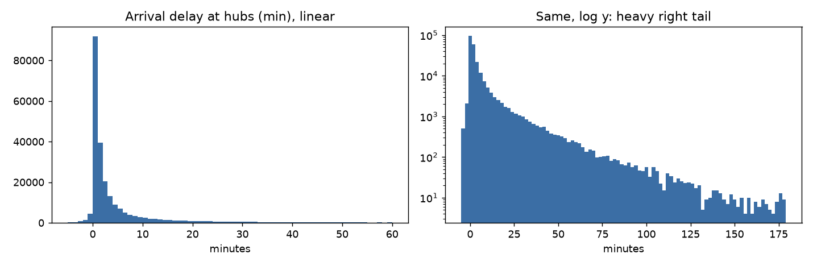
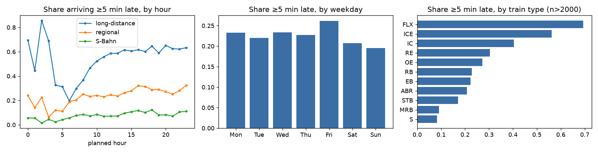
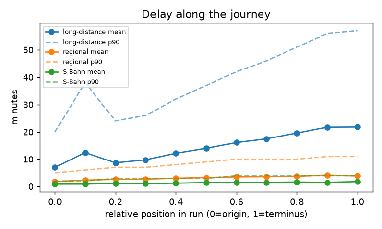

# 01 — Exploratory data analysis

Reproduce: `uv run python -m cre.ingest.hf_loader && uv run python notebooks/01_eda.py`
(raw numbers in `reports/eda_stats.txt`, figures in `reports/figures/`).

## Scope loaded

| | |
|---|---|
| Source | HF `piebro/deutsche-bahn-data`, `monthly_processed_data`, 2026-08 … 2026-10 |
| Rows | 4,719,154 stop events (every stop of every run that calls at a hub) |
| Runs | 272,408 (see "ride id" below) |
| Stations | 1,034 distinct EVAs touched by those runs |
| Date range | 2026-07-31 22:15 → 2026-10-31 23:59 (planned) |
| Hub EVAs | Leipzig 08010205 + 08098205 (tunnel), Erfurt 08010101, Halle 08010159, Berlin 08011160 + 08098160 (tief) + 08089021 (S-Bahn) |

## Schema (columns we keep)

`id, eva, station_name, train_type, train_number, line_number, final_destination_station,
train_line_ride_id, train_line_station_num, arrival_planned_time, arrival_change_time,
departure_planned_time, departure_change_time, arrival_is_canceled, departure_is_canceled,
delay_in_min, is_additional_stop, is_replacement_train`. The full dataset has 24 columns; we drop
`xml_station_name`, `replaced_*`, `has_plan_record`.

Also on HF: `monthly_processed_data_change` (change-feed **snapshots** with platforms and status) and
`_plan`. Snapshots per stop are few (median 2) and **~6 h apart**, so they can't give "the forecast
30 min before arrival" (see DECISIONS).

## How things are represented

- **One row per (run, stop).** Arrival fields are null at the origin, departure fields null at the terminus.
- **Delay**: `*_change_time` is the latest known (= realized, for past events) time. `delay_in_min` is the
  *departure* delay, falling back to arrival delay. Validated: it matches 100% of rows. We recompute
  arrival and departure delay separately and do not use `delay_in_min`.
- **Cancellations**: `arrival_is_canceled` / `departure_is_canceled` per stop. ~2.6–2.7% of hub stop events.
- **Stop sequences**: `train_line_station_num` = stop index within the run.
- **Platform changes**: **not in the processed table.** They only exist in the change snapshots.
  Out of scope for features. Logged.

## Data problems found

| # | Problem | Size | Handling |
|---|---|---|---|
| 1 | **`train_line_ride_id` is not one run.** It's a recurring line id; (ride_id, stop#) is duplicated 112k times and stop order matches time order only 50% of the time | all rows | Derive `run_id = ride_id + start timestamp` parsed from `id` (`<ride>-<YYMMDDHHMM>-<stop#>`). On run_id: (run, stop#) unique, time-ordered 99.92% |
| 2 | **Cancelled stops still carry change times** | 99.999% of cancelled arrivals | Never treat a time as realized if the stop is cancelled |
| 3 | **Departs before it arrives** (actual dep < actual arr at the same stop) | 15,612 rows (10,358 non-cancelled), median 1 min, mostly S-Bahn; in 99.96% of them the dep delay < arr delay | A stale departure forecast. Effective actual departure = `max(dep, arr)` |
| 4 | Runs have gaps in stop# (not every station is crawled) | 8.5% of runs non-contiguous | Use "previous *observed* stop", never `stop# − 1` |
| 5 | Hub rows with no planned time at all | 436 | Dropped (can't define a transfer) |
| 6 | Extreme values: arrival >300 min late / >30 min early | 71 / 134 rows | Kept for labels (they're real outcomes); range-checked in contracts; early > 30 min flagged invalid |
| 7 | Partial edge days (2026-07-31, 08-01, 08-02) | 17 / ~2,400 rows vs median 3,382 | 07-31 dropped; first days kept |
| 8 | DST fall-back night 2026-10-25: local naive timestamps are ambiguous 02:00–03:00 | 453 rows in window | Kept; ambiguity documented (worst case ±60 min on ~0.01% of rows) |
| 9 | Same physical train at a hub under two run ids | 4 cases | Negligible; dedup on (train_number, eva, planned dep) |

## What the data says (figures)

- **Heavy tail.** Arrival delay at hubs: median 1 min, p90 13, p95 26, p99 65. 22.6% arrive ≥5 min
  late, 9.4% ≥15. The tail is roughly exponential (straight on log-y). A mean-based model would be
  dominated by the tail. That's one reason we model P(miss) directly, not E[delay].

- **Train type dominates.** ≥5 min late: FLX ~69%, ICE ~56%, IC ~40%, RE ~30%, S-Bahn ~8%. Long-distance
  trains arriving at a hub are late more often than not.
- **Hour of day** matters for long-distance (from ~20% at 06:00 to ~60% from noon on: delay
  accumulates during the day). Night hours are noisy (few trains).
- **Weekday**: Friday is worst (~26%), Sunday best (~19%). A modest effect.

- **Delay accumulates along the run** for long-distance trains (mean ~7 → 22 min, p90 ~20 → 57). It stays
  flat for regional and S-Bahn. So *A's delay at its previous stops* should be a strong, legitimately
  available predictor, and *where in its run A is* matters.

## Implications for the next phases

1. Build everything on `run_id`, never on `train_line_ride_id`.
2. Labels must use cancellation flags first, times second, and `max(dep, arr)` for departures.
3. Expect a strongly type-dependent base rate. Report results by train-type pair.
4. No platform data and no fine-grained forecast history. The feature set is upstream realized delays + context.
